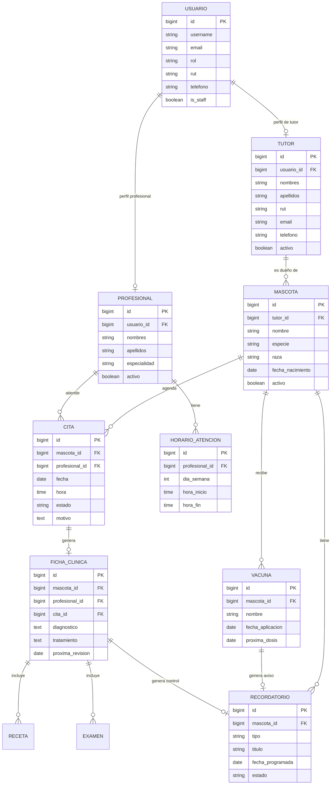

# Guía de defensa oral — PetCare (EVA 3)

**Proyecto:** PetCare — Sistema de Gestión de Clínica Veterinaria
**Asignatura:** Desarrollo Backend · **Docente:** Marcelo Alvarado
**Estudiante:** Cesar Antonio Aedo Álvarez · **Sección:** IEC-N4-C2 · **Grupo:** 1
**Año:** 2026

Esta guía resume qué mostrar, en qué orden y qué responder en la defensa. Está
basada en la misma estructura de la EVA 2 (CarritoShop), adaptada al dominio
veterinario de PetCare.

---

## 1. Checklist rápido de la entrega

| Requisito | Dónde se demuestra | Estado |
|---|---|---|
| PostgreSQL como motor real | `petcare_project/settings.py`, `init_db.sql`, `/health/` | OK |
| CRUD completo | Módulos de tutores, mascotas, profesionales, horarios, citas, fichas, vacunas y recordatorios | OK |
| 4 casos de negocio | Agenda, ficha clínica, vacunas/recordatorios, permisos por rol | OK |
| Django Admin personalizado | `/admin/` con inlines, filtros, búsqueda y acciones | OK |
| API REST + JWT | `/api/` + `/api/auth/token/` | OK |
| Documentación OpenAPI | `/api/docs/`, `/api/redoc/`, `/api/schema/` | OK |
| Seguridad y sesiones | Login, CSRF, roles, cookies, `DEBUG=False` | OK |
| Registro de IA | `prompts_ia.md` | OK |
| Despliegue AWS EC2 | <http://107.20.193.17/> con Nginx + Gunicorn + PostgreSQL | OK |
| Pruebas automatizadas | `python manage.py test petcare` → **34 tests OK** | OK |
| Fallback de rutas | `re_path` comodín en `petcare_project/urls.py` | OK |

---

## 2. Modelo de datos



Puntos clave para explicar:

- `Usuario` es un `AbstractUser` con `TextChoices` para los cuatro roles.
- `Tutor` y `Profesional` se relacionan 1:1 con `Usuario`.
- `Cita` usa dos `UniqueConstraint` condicionales para impedir choques activos.
- `Recordatorio` se enlaza 1:1 con `Vacuna` o `FichaClinica` para automatizar avisos.

---

## 3. Roles y permisos

| Rol | Puede ver | Puede modificar |
|---|---|---|
| **Administrador** | Todo | Todo, incluido Django Admin, profesionales, horarios y usuarios |
| **Veterinario** | Agenda, mascotas, fichas, vacunas y recordatorios | Fichas clínicas, vacunas, citas y recordatorios clínicos |
| **Recepcionista** | Agenda, tutores, mascotas, profesionales y horarios | Tutores, mascotas y citas (no profesionales, horarios ni fichas) |
| **Tutor** | Solo sus mascotas, citas, fichas, vacunas y recordatorios | Solicitar y cancelar sus propias citas |

Implementación:

- `petcare/permissions.py`: permisos DRF por rol y por objeto.
- Decorador `rol_requerido` en `petcare/views.py` para las vistas HTML.
- Consultas filtradas: `mascotas_visibles`, `citas_visibles`, `fichas_visibles`,
  `vacunas_visibles` y `recordatorios_visibles`.
- `PermisoCitas`: permite a un tutor `create` y `cancelar`, pero valida que la
  mascota sea suya y que no pueda confirmar ni atender citas.
- `PuedeVerDocumentacionAPI`: solo personal de la clínica con sesión iniciada.

Demostración sugerida:

1. Entrar como `tutor` y mostrar que `/tutores/` responde **403**.
2. Mostrar que en `/mascotas/` solo aparece `Luna`.
3. Entrar como `admin` y mostrar que aparecen las 3 mascotas y todos los módulos.
4. Abrir `/api/docs/` como tutor → **403**; como admin → **200**.

---

## 4. Las 4 reglas de negocio

### 4.1 Agenda sin choques

`Cita.clean()` y `Cita.save()` validan:

1. Fecha no pasada al crear.
2. Profesional activo.
3. Mascota activa.
4. El profesional tiene un `HorarioAtencion` para ese día.
5. La hora está dentro del bloque y cae en un múltiplo de 30 minutos.
6. No existe otra cita activa del profesional en el mismo bloque.
7. No existe otra cita activa de la mascota en el mismo bloque.
8. Cancelar libera el cupo porque las restricciones solo aplican a
   `PROGRAMADA` y `CONFIRMADA`.

Demostración: crear una cita a las 10:00 y intentar otra a las 10:00 con el
mismo profesional; Django muestra el error de validación. Luego cancelar y
verificar que el bloque vuelve a estar disponible.

### 4.2 Ficha clínica completa

- Una cita puede generar una `FichaClinica` (1:1).
- La ficha guarda diagnóstico, tratamiento, signos vitales y próxima revisión.
- `Receta` y `Examen` se gestionan con formularios inline.
- Solo veterinario o administrador pueden crearla/editar.
- Si se indica `proxima_revision`, se genera automáticamente un recordatorio.

### 4.3 Vacunas y recordatorios automáticos

- `Vacuna` valida que `proxima_dosis >= fecha_aplicacion`.
- Al guardar una vacuna con `proxima_dosis`, una señal `post_save` crea o
  actualiza un `Recordatorio` tipo `VACUNA`.
- Al guardar una ficha con `proxima_revision`, se crea o actualiza un
  `Recordatorio` tipo `CONTROL`.
- Si se elimina la vacuna/ficha, la relación 1:1 con `on_delete=CASCADE`
  elimina el recordatorio asociado. Si solo se borra la fecha, la señal
  `post_save` elimina el aviso pendiente.
- Si la fecha cambia, el recordatorio se actualiza y vuelve a `PENDIENTE`.

Demostración: crear una vacuna con próxima dosis y mostrar el recordatorio
generado en `/recordatorios/`.

### 4.4 Permisos por rol y por objeto

- El tutor solo ve sus datos; no puede crear mascotas ni fichas.
- La recepcionista gestiona agenda y datos administrativos, pero no fichas.
- El veterinario gestiona lo clínico.
- El administrador tiene acceso total.
- En la API se aplica lo mismo con permisos DRF y validaciones de serializer.

Demostración: JWT de tutor contra `/api/mascotas/` devuelve solo `Luna`;
`POST /api/mascotas/` devuelve **403**.

---

## 5. Django Admin personalizado

Abrir `/admin/` con `admin / AdminPetCare2026!` y mostrar:

1. **Cabecera personalizada:** “PetCare · Administración Veterinaria”.
2. **Citas:** columnas con estado coloreado, filtros por estado/fecha,
   búsqueda por mascota/profesional, `date_hierarchy` y acciones masivas
   para confirmar, cancelar o marcar como atendida.
3. **Tutores:** inline de mascotas; búsqueda por RUT, nombre y correo.
4. **Mascotas:** inline de citas, vacunas y recordatorios; filtro por especie
   y estado.
5. **Fichas clínicas:** inlines de recetas y exámenes.
6. **Profesionales:** inline de horarios de atención.
7. **Recordatorios:** acciones para marcar como enviados o completados.
8. **Usuarios:** rol, `is_staff` y permisos.

Frase para la defensa: “El admin no es el de Django por defecto: tiene
`list_display`, `list_filter`, `search_fields`, `date_hierarchy`, inlines,
acciones masivas y cabeceras propias. Eso permite operar la clínica sin
entrar a la API.”

---

## 6. API REST y JWT

### Login

```bash
curl -X POST http://107.20.193.17/api/auth/token/ \
  -H "Content-Type: application/json" \
  -d '{"username":"tutor","password":"TutorPetCare2026!"}'
```

Respuesta: `access`, `refresh` y datos del usuario con `rol`.

### Uso

```bash
curl http://107.20.193.17/api/mascotas/ \
  -H "Authorization: Bearer <ACCESS_TOKEN>"
```

### Endpoints principales

| Recurso | Ruta |
|---|---|
| Tutores | `/api/tutores/` |
| Mascotas | `/api/mascotas/` |
| Profesionales | `/api/profesionales/` |
| Horarios | `/api/horarios/` |
| Citas | `/api/citas/` |
| Disponibilidad | `/api/citas/disponibilidad/?profesional=1&fecha=2026-11-02` |
| Confirmar / cancelar / atender | `POST /api/citas/{id}/confirmar/`, `/cancelar/`, `/atender/` |
| Fichas | `/api/fichas/` |
| Vacunas | `/api/vacunas/` |
| Recordatorios | `/api/recordatorios/` |

### Documentación restringida

- `/api/docs/` y `/api/schema/` requieren sesión de personal de la clínica.
- Anónimo → **401**; tutor → **403**; admin/veterinario/recepción → **200**.
- El esquema se descarga como `petcare-schema.json` (nombre ASCII) para evitar
  problemas de cabeceras con acentos en navegadores y proxies.

---

## 7. Seguridad y sesiones

- `DEBUG=False` en producción.
- `SECRET_KEY` y credenciales de base en `.env` con permisos `600`.
- `ALLOWED_HOSTS` restringido a la IP elástica y localhost.
- `CSRF_TRUSTED_ORIGINS` configurado para la IP pública.
- Cookies de sesión y CSRF; login con `LoginView` de Django.
- Contraseñas con validadores de Django.
- Permisos por rol en HTML y API.
- PostgreSQL escucha solo en `127.0.0.1:5432`.
- Gunicorn escucha solo en `127.0.0.1:8000`.
- Nginx publica solo el puerto 80 (y 443 si se agrega TLS).
- Puertos 5432 y 8000 no están expuestos en el Security Group.

Si preguntan por HTTPS: la entrega usa IP elástica sin dominio ni certificado.
`check --deploy` muestra 4 advertencias esperables (`HSTS`, `SSL_REDIRECT`,
`SESSION_COOKIE_SECURE`, `CSRF_COOKIE_SECURE`). Con un dominio se activa
Let's Encrypt y `DJANGO_USE_HTTPS=True`.

---

## 8. Fallback de rutas (igual que EVA 2 / CarritoShop)

En `petcare_project/urls.py`:

```python
re_path(
    r'^(?!admin(?:/|$)|api(?:/|$)|static(?:/|$)|media(?:/|$)).*$',
    redirect_to_home,
    name='catch_all',
)
```

Comportamiento:

- `/ruta-que-no-existe/` → redirige a `/`.
- `/login` → redirige a `/login/` (conserva `APPEND_SLASH`).
- `/admin/` → no se captura; sigue funcionando el admin.
- `/api/...` desconocida → 404 (la API no se redirige).
- `/static/` y `/media/` → no se capturan.

Frase para la defensa: “Implementé el mismo fallback `re_path` de la EVA 2,
pero con exclusiones para no romper el admin, la API ni los estáticos.”

---

## 9. Despliegue AWS

```text
Internet
   │ HTTP :80
   ▼
Nginx (EC2 · IP elástica 107.20.193.17)
   │ proxy_pass 127.0.0.1:8000
   ▼
Gunicorn (systemd: petcare.service, 2 workers)
   │
   ▼
PostgreSQL 16 (127.0.0.1:5432)
```

Comandos de verificación:

```bash
sudo systemctl status petcare nginx postgresql
curl -I http://107.20.193.17/
curl http://107.20.193.17/health/
cd /home/ubuntu/petcare && venv/bin/python manage.py test petcare
```

---

## 10. Guion de demostración (10–12 minutos)

1. **Portada pública** (`/`): explicar que es la landing; mostrar botones
   “Ingresar” y “Crear cuenta”.
2. **Login admin** (`/login/`): entrar con `admin / AdminPetCare2026!`.
3. **Dashboard**: métricas, próximas citas, recordatorios y accesos rápidos.
4. **CRUD de mascotas**: crear/editar una mascota y mostrar validaciones.
5. **Citas**: crear una cita, intentar un choque de horario y cancelar.
6. **Ficha clínica**: crear una ficha con receta/examen y próxima revisión.
7. **Vacunas/recordatorios**: crear vacuna con próxima dosis y mostrar el aviso.
8. **Permisos**: cerrar sesión, entrar como `tutor`, comprobar 403 y alcance.
9. **API**: abrir `/api/docs/` como admin, autorizar con JWT y probar un GET.
10. **Django Admin**: mostrar personalización, inlines y acciones.
11. **Fallback**: abrir `/cualquier-ruta` y ver que vuelve a `/`.
12. **AWS**: mostrar `systemctl status`, `/health/` y la URL pública.

---

## 11. Preguntas frecuentes del docente

**¿Por qué PostgreSQL y no SQLite?**
Porque la pauta lo exige y porque necesito restricciones condicionales,
transacciones y concurrencia real. SQLite no permite demostrar los bloqueos
de agenda de la misma forma.

**¿Dónde están las 4 reglas de negocio?**
Agenda sin choques (`Cita.clean`), ficha clínica completa
(`FichaClinica` + inlines), recordatorios automáticos (`signals.py`) y
permisos por rol/objeto (`permissions.py` + consultas filtradas).

**¿Cómo evitas que un tutor vea datos de otro?**
Dos capas: las vistas HTML filtran por `request.user` y la API usa
`get_queryset()` + permisos de objeto. Un tutor que intenta acceder a una
mascota ajena recibe 403 o 404.

**¿Cómo funciona el JWT?**
`SimpleJWT` emite `access` y `refresh`; el serializer personalizado agrega
`rol` y datos del usuario. En cada request, `JWTAuthentication` valida la
firma y carga `request.user`; los permisos leen el rol.

**¿Qué pasa si dos personas agendan el mismo bloque?**
La validación de `clean()` lo detecta y, además, la base tiene
`UniqueConstraint` condicionales para `PROGRAMADA`/`CONFIRMADA`. Si se
cancela, la restricción deja de aplicar y el cupo se libera.

**¿Cómo se generan los recordatorios?**
Con señales `post_save`/`post_delete` en `petcare/signals.py`. Son
idempotentes: si la fecha cambia, actualizan el aviso; si se elimina el
origen, borran el aviso pendiente.

**¿Por qué la documentación no es pública?**
Porque expone la superficie de la API. Solo el personal de la clínica con
sesión iniciada puede verla; un tutor recibe 403 y un anónimo 401.

**¿Qué es el `re_path` del final?**
Un fallback que redirige rutas web desconocidas a la portada, igual que en
la EVA 2, excluyendo admin, API y estáticos.

**¿Qué mejorarías con más tiempo?**
HTTPS con dominio, envío real de correos/WhatsApp para recordatorios,
paginación en el admin y pruebas de concurrencia con transacciones.

---

## 12. Credenciales demo

| Rol | Usuario | Contraseña |
|---|---|---|
| Administrador | `admin` | `AdminPetCare2026!` |
| Veterinario | `veterinario` | `VetPetCare2026!` |
| Recepcionista | `recepcion` | `Recepcion2026!` |
| Tutor | `tutor` | `TutorPetCare2026!` |

---

## 13. Enlaces

- Aplicación: <http://107.20.193.17/>
- Django Admin: <http://107.20.193.17/admin/>
- Swagger: <http://107.20.193.17/api/docs/>
- Redoc: <http://107.20.193.17/api/redoc/>
- Repositorio: <https://github.com/Cesarsip/Eva3ProgramacionBackEnd>
